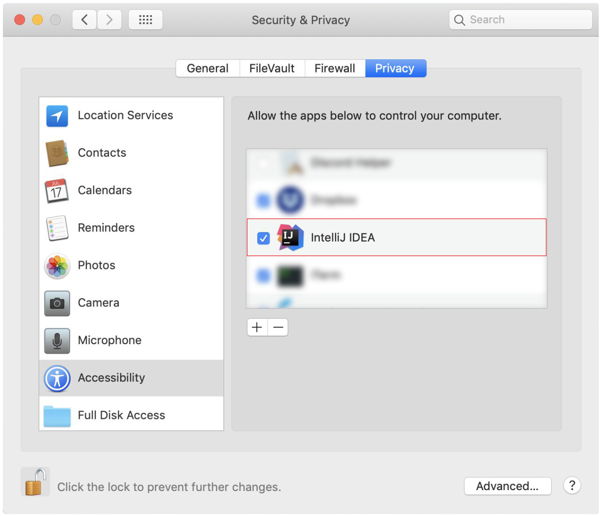

# Testing guide

<!-- * Table of Contents -->
<page-nav-print />

<!-- -------------------------------------------------------------------------------------------------------------------- -->

## Running tests

You can run tests in two ways.

 **Method 1: Using IntelliJ JUnit test runner**

To run all tests, right-click on the `src/test/java` folder and choose `Run 'All Tests'`

To run a subset of tests, you can right-click on a test package,
    test class, or a test and choose `Run 'ABC'`

 **Method 2: Using Gradle**

 Open a console and run the command `gradlew clean test` (Mac/Linux: `./gradlew clean test`)

 **Method 3: Using Gradle (headless)**

Thanks to the [TestFX](https://github.com/TestFX/TestFX) library we use, our GUI tests can be run in the _headless_ mode. In the headless mode, GUI tests do not show up on the screen. That means the developer can do other things on the Computer while the tests are running.

To run tests in headless mode, open a console and run the command `gradlew clean headless allTests` (Mac/Linux: `./gradlew clean headless allTests`)

<box type="info" seamless>

**Link**: Read [this Gradle Tutorial from the se-edu/guides](https://se-education.org/guides/tutorials/gradle.html) to learn more about using Gradle.
</box>

--------------------------------------------------------------------------------------------------------------------

## Types of tests

This project has two types of tests:
1. **GUI Tests** - These are tests involving the GUI. 
    - *Unit tests* target the individual components. These are in the `seedu.address.ui` package.
2. **Non-GUI Tests** - These are tests not involving the GUI.
    - *Unit tests* target the lowest-level methods and classes. 
       For example: `seedu.address.commons.StringUtilTest`
    - *Integration tests* check how multiple code units work together; the individual units are assumed to work. 
       For example: `seedu.address.storage.StorageManagerTest`
    - *Hybrid tests* combine unit and integration testing. These tests check both the individual units and how they work together. 
       For example: `seedu.address.logic.LogicManagerTest`

## Troubleshooting Testing
**Problem: `HelpWindowTest` fails with a `NullPointerException`.**

* Reason: One of its dependencies, `HelpWindow.html` in `src/main/resources/docs` is missing.
* Solution: Execute Gradle task `processResources`.

**Problem: Keyboard and mouse movements are not simulated on macOS Mojave, resulting in GUI Tests failure.**

* Reason: From macOS Mojave onwards, applications without `Accessibility` permission cannot simulate certain keyboard and mouse movements.
* Solution: Open `System Preferences`, click `Security and Privacy` -> `Privacy` -> `Accessibility`, and check the box beside `Intellij IDEA`.

Figure 1. `Accessibility` permission is granted to `IntelliJ IDEA`
