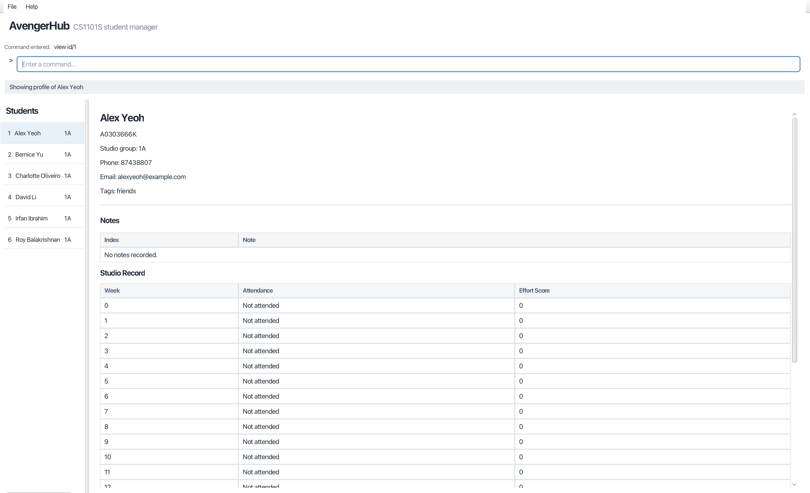
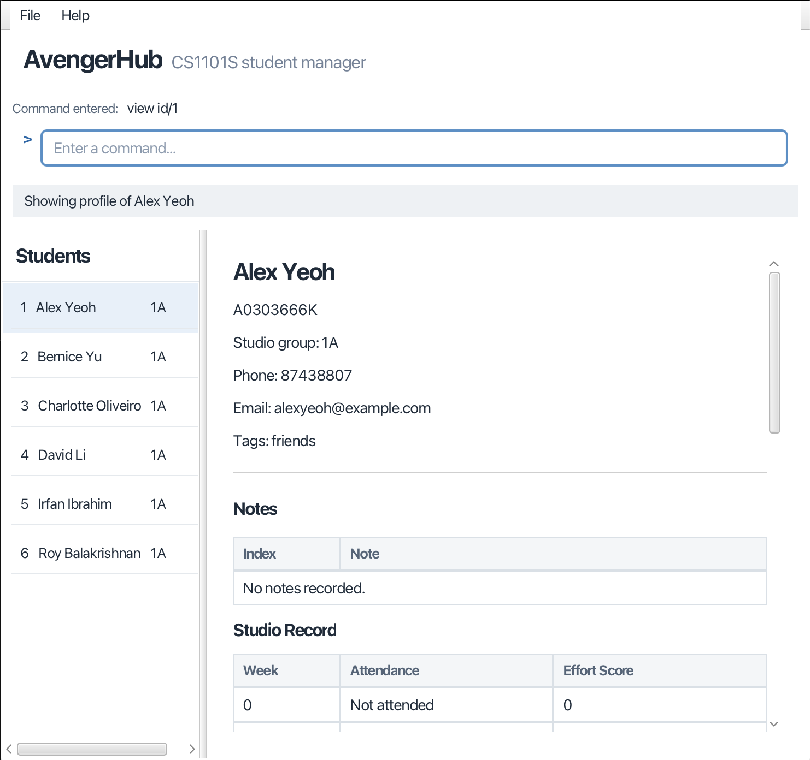
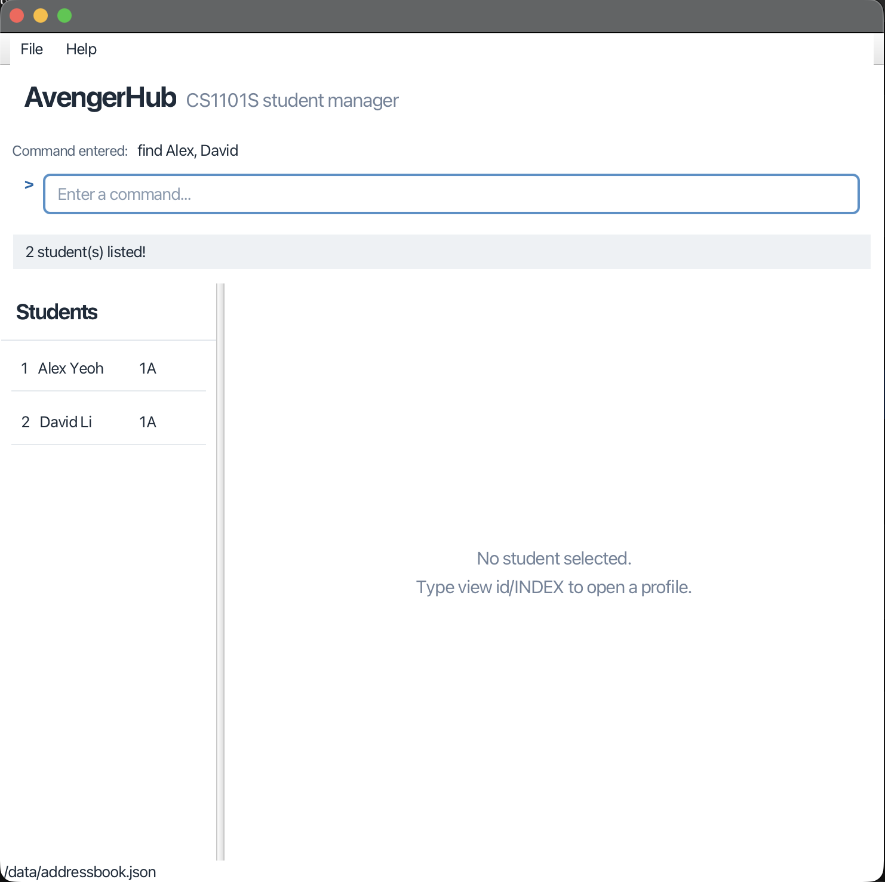
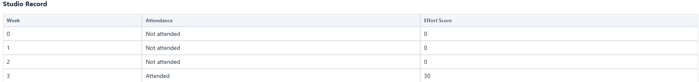
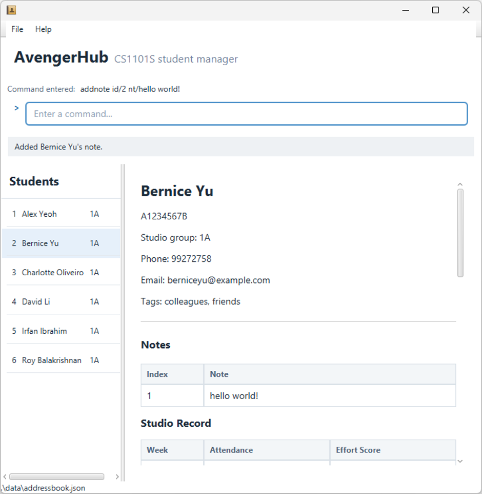
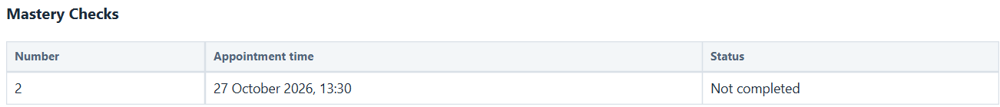
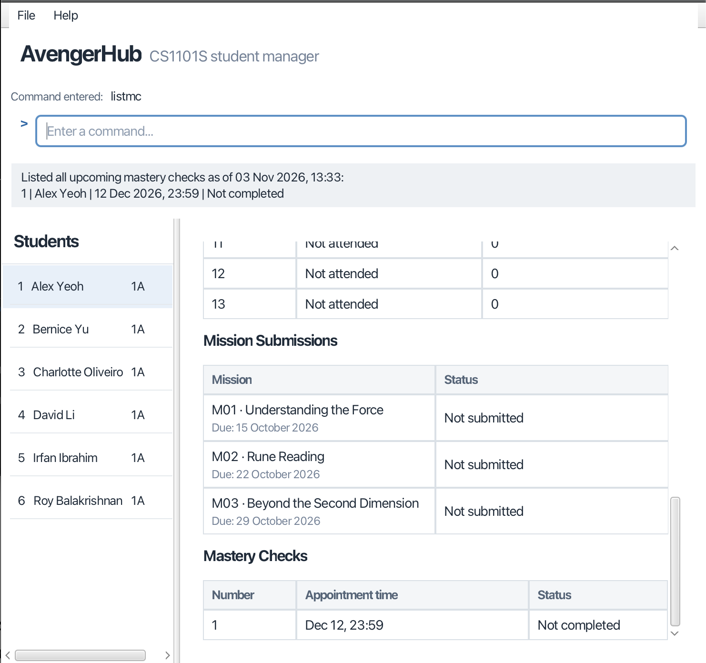
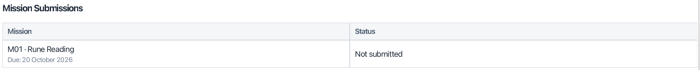
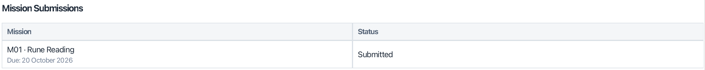
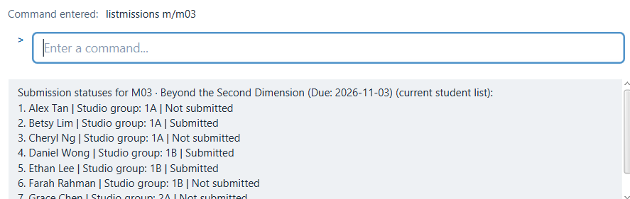

# AvengerHub User Guide

AvengerHub is a **desktop address book application for managing students, optimized for use through a Command Line Interface (CLI)** while retaining the benefits of a Graphical User Interface (GUI). If you type quickly, AvengerHub can help you manage students faster than traditional GUI applications.

<!-- * Table of Contents -->
<page-nav-print />

--------------------------------------------------------------------------------------------------------------------

## Quick start

1. Ensure that Java `25` or later is installed on your computer.<br>
   **Mac users:** Ensure you have the precise JDK version prescribed [here](https://se-education.org/guides/tutorials/javaInstallationMac.html).

1. Download the latest `.jar` file from [here](https://github.com/AY2627S1-CS2103T-F14a-1/tp/releases).

1. Copy the file to the folder you want to use as the _home folder_ for your AvengerHub.

1. Open a terminal, `cd` to the folder containing the JAR file, and run `java -jar avengerhub.jar`.<br>
   A GUI similar to the one below should appear in a few seconds. Note how the app contains some sample data in its address book.<br>
   

1. Type a command in the command box and press Enter to execute it. For example, type **`help`** and press Enter to open the help window.<br>
   Some example commands you can try:

   * `list` : Lists all students.

   * `addstudent n/John Doe mtc/A0409127H p/98765432 e/johnd@example.com g/1A` : Adds a student named `John Doe` to the Address Book.

   * `delstudent id/3` : Deletes the 3rd student shown in the current list.

   * `clear` : Deletes all students.

   * `exit` : Exits the app.

1. Refer to the [Features](#features) section below for details of each command.

--------------------------------------------------------------------------------------------------------------------

## Features

<box type="info" seamless>

**Notes about the command format:**<br>

* Words in `UPPER_CASE` are the parameters to be supplied by the user.<br>
  For example, in `addstudent n/NAME`, replace `NAME` with a value such as `John Doe`.

* Items in square brackets are optional.<br>
  For example, `n/NAME [t/TAG]` can be used as `n/John Doe t/friend` or as `n/John Doe`.

* Items followed by `...` can appear zero or more times.<br>
  For example, `[t/TAG]... ` may be omitted, or written as `t/friend` or `t/friend t/family`.

* Prefixed parameters can be in any order unless a command states otherwise.<br>
  For example, if the command specifies `n/NAME p/PHONE_NUMBER`, `p/PHONE_NUMBER n/NAME` is also acceptable.

* Prefixes are case-insensitive.<br>
  For example, `n/John Doe` and `N/John Doe` both specify the same name parameter.

* Commands that take no parameters ignore extra arguments.<br>
  The `list` command displays a warning when extra arguments are ignored.
  The other commands ignore extra arguments without a warning.<br>
  For example, `help 123` is interpreted as `help` without a warning.

* If you are using a PDF version of this document, be careful when copying and pasting commands that span multiple lines as space characters surrounding line-breaks may be omitted when copied over to the application.
</box>

### Viewing help: `help`

Opens the help window containing usage instructions for the commands.

Any arguments provided after `help` are ignored.


Format: `help`


### Adding a student: `addstudent`

Adds a student to the address book.

Format: `addstudent n/NAME mtc/MATRICULATION_NUMBER p/PHONE_NUMBER e/EMAIL [t/TAG]... g/STUDIO_GROUP`

* `MATRICULATION_NUMBER` is that supplied by NUS for every student, starting with A followed by seven digits, then an uppercase letter from A-Z. 
* **Matriculation number must be unique for each student**, otherwise the command will be rejected.

<box type="tip" seamless>

**Tip:** A student can have any number of tags, including zero.
</box>

Examples:
* `addstudent n/John Doe mtc/A0123456C p/98765432 e/johnd@example.com g/1A`
* `addstudent n/Betsy Crowe t/talkative mtc/A0312777K e/betsycrowe@example.com p/1234567 t/smart g/1A`

### Listing all students: `list`

Shows a list of all students in the address book.

Format: `list`

* Resets the current student filter to show all students.
* Extra arguments are ignored with a warning; the command still lists all students.
* Surrounding whitespace does not trigger a warning.

For example, `list missions m/01` lists all students and displays:

```text
Listed all students.
WARNING:
Extra arguments were ignored. The list command takes no arguments.
```

To list mission submissions, use `listmissions m/MISSION_ID`. See its section below.

### Viewing a student: `view`

Displays the profile of a student in the currently displayed student list.

Format: `view id/INDEX`

* `INDEX` refers to the student's index in the currently displayed list,
  including results from `find`.
* The index must be a positive integer identifying a displayed student.
* The profile displays the student's name, studio group, phone number,
  email address, tags, studio records, mission submissions, mastery checks, and notes.
* Viewing preserves student records, submission records, and the current filter.
* Missing, invalid, or out-of-range indexes produce an error without changing
  stored records.

Examples:

* `list`, followed by `view id/2`, displays the second student's profile.
* `find Betsy Crowe`, followed by `view id/1`, displays the first student
  in those search results.

For example, viewing Alex Yeoh displays the feedback:

```text
Showing profile of Alex Yeoh
```



### Editing a student: `editstudent`

Edits an existing student in the address book.

Format: `editstudent id/INDEX [n/NAME] [mtc/MATRICULATION_NUMBER] [p/PHONE] [e/EMAIL] [t/TAG]... [g/STUDIO_GROUP]`

* Edits the student at the specified `INDEX`. The index refers to the index number shown in the displayed student list. The index **must be a positive integer** 1, 2, 3, ...
* At least one of the optional fields must be provided.
* Matriculation number cannot be changed to another address book student's matriculation number.
* Existing values will be updated to the input values.
* When editing tags, all of the student's existing tags are removed; adding tags is not cumulative.
* To remove all of a student's tags, enter `t/` without a tag after it.

Examples:
*  `editstudent id/1 p/91234567 e/johndoe@example.com` Edits the phone number and email address of the 1st student to be `91234567` and `johndoe@example.com` respectively.
*  `editstudent id/2 n/Betsy Crower t/` Edits the name of the 2nd student to be `Betsy Crower` and clears all existing tags.

### Locating students by name or studio group: `find`

Finds students whose names match all keywords within at least one
comma-separated alternative, optionally restricted to studio groups.

Format: `find [NAME_WORDS [, MORE_NAME_WORDS]...] [g/STUDIO_GROUP]...`

* Provide at least one name alternative or studio group.
* Name matching is case-insensitive and allows partial matches.
* Spaces mean AND: `alex lee` requires both words, in any order.
* Repeating a word within an alternative requires separate, non-overlapping
  occurrences, ignoring case. For example, `alex alex` matches `Alex Alex`
  and `Alex Alexander`, but not `Alex Yeoh`.
* Comma-separated alternatives are independent: `alex, alex` has the same
  effect as `alex`.
* Commas mean OR: `alex lee, brian` matches both `alex` and `lee`,
  or matches `brian`.
* Spaces around commas are optional.
* Empty alternatives are invalid: do not begin or end the name search
  with a comma, or use consecutive commas.
* Studio groups match exactly.
* Repeated group filters mean OR: `g/1A g/1B` matches either group.
* When names and groups are supplied, both filters must match.
* Place name alternatives before studio-group filters.

Examples:
* `find ale lee` matches `Alex Lee`, but not `Alex Lim`.
* `find alex, david` matches `Alex Lee` and `David Li`.
* `find alex, brian g/1A` matches Alex or Brian within studio group 1A.
* `find g/1A g/1B` finds students in either studio group.
  

### Deleting a student: `delstudent`

Deletes the specified student from the address book.

Format: `delstudent id/INDEX`

* Deletes the student at the specified `INDEX`.
* The index refers to the index number shown in the displayed student list.
* The index **must be a positive integer** 1, 2, 3, ...

Examples:
* `list` followed by `delstudent id/2` deletes the 2nd student in the address book.
* `find Betsy` followed by `delstudent id/1` deletes the 1st student in the results of the `find` command.

### Adding studio records: `addstudiorecord`

Records a student's studio attendance and effort for a studio week.

Format: `addstudiorecord id/INDEX w/WEEK ef/EFFORT`

* Adds a studio record for the student at the specified `INDEX` for the specified `WEEK`, with the specified `EFFORT` score.
* The index refers to the index number shown in the displayed student list. 
* The index **must be a positive integer** 1, 2, 3, ...
* The week must be an integer from **0 to 13**, inclusive.
* The effort score must be a whole number from **0 to 2147483647**, inclusive.
* Weeks without a record shown are considered absent with an effort score of `0`.
* If the studio record was already recorded, the records remain unchanged.
* The current list filter stays active.

Examples:

* `list` followed by `addstudiorecord id/1 w/3 ef/30` records attendance and an effort score of 30 for week 3 for the first student displayed, if any.
* `find Betsy` followed by `addstudiorecord id/1 w/13 ef/0` records attendance and an effort score of 0 for week 13 for the first student in the search results, if any.

For example, if the first student is Amy Bee and her week 3 studio record is not yet recorded, `addstudiorecord id/1 w/3 ef/30` displays:

```text
Added Amy Bee's studio record for studio week 3.
```


### Deleting studio records: `delstudiorecord`

Removes a student's attendance record and effort score for a studio week. The student remains in the address book.

Format: `delstudiorecord id/INDEX w/WEEK`

* Deletes a studio record for the student at the specified `INDEX` for the specified `WEEK`.
* The index refers to the index number shown in the displayed student list.
* The index **must be a positive integer** 1, 2, 3, ...
* The week must be an integer from **0 to 13**, inclusive.
* If the studio record was already not recorded, the records remain unchanged.
* The current list filter stays active.

Examples:

* `list` followed by `delstudiorecord id/1 w/3` removes the first student's week 3 studio record, if recorded, if any.
* `find Betsy` followed by `delstudiorecord id/1 w/13` removes the week 13 studio record for the first student in the search results, if any.

For example, if the first student is Amy Bee and her week 3 studio record is recorded, `delstudiorecord id/1 w/3` displays:

```text
Removed Amy Bee's record for studio week 3.
```

### Editing studio records: `editstudiorecord`

Edit a student's studio effort for a studio week.

Format: `editstudiorecord id/INDEX w/WEEK ef/EFFORT`

* Edits a studio record for the student at the specified `INDEX` for the specified `WEEK`, with the specified `EFFORT` score.
* The index refers to the index number shown in the displayed student list.
* The index **must be a positive integer** 1, 2, 3, ...
* The week must be an integer from **0 to 13**, inclusive.
* The effort score must be a whole number from **0 to 2147483647**, inclusive.
* If the studio record was already not recorded, the records remain unchanged.
* If the studio record's existing effort score is the same as the specified effort score, the records remain unchanged.
* The current list filter stays active.

Examples:

* `list` followed by `editstudiorecord id/1 w/3 ef/30` edits studio record's effort score to 30 for week 3 for the first student displayed, if any.
* `find Betsy` followed by `editstudiorecord id/1 w/13 ef/0` edits studio's effort score to 0 for week 13 for the first student in the search results, if any.

For example, if the first student is Amy Bee and her week 3 studio record is recorded, `editstudiorecord id/1 w/3 ef/30` displays:

```text
Edited Amy Bee's studio record for studio week 3.
```

### Adding a student note: `addnote`

Adds a simple note for an existing student in the address book.

Format: `addnote id/INDEX nt/TEXT`

* Adds a note with text `TEXT` for the student at the specified `INDEX`.
* The index refers to the index number shown in the displayed student list.
* The index **must be a positive integer** 1, 2, 3, ...
* The text should only contain alphanumeric characters, punctuation, and spaces, should not be blank, and be less than or equal to 1000 characters.
* A student can have up to 100 notes.
* Indexes of notes with potentially duplicate text will be shown as a warning, but the note will still be added. This is to provide more flexibility for tutors.
* When checking for duplicate note texts, AvengerHub ignores capitalization and collapses repeated spaces. Leading and trailing spaces are also ignored.
* The current list filter stays active.

Examples:
*  `addnote id/1 nt/hello` Adds a note with text `hello` for the 1st student.

For example, if the first student is Amy Bee, `addnote id/1 nt/hello` displays:

```text
Added Amy Bee's note.
```



### Deleting a student note: `delnote`

Deletes a note for an existing student in the address book.

Format: `delnote id/INDEX ni/NOTE_INDEX`

* Deletes a note with index `NOTE_INDEX` for the student at the specified `INDEX`.
* The index refers to the index number shown in the displayed student list.
* The index **must be a positive integer** 1, 2, 3, ...
* The note index refers to the index number shown in the list of notes for a given student in the display panel.
* The note index must be an integer from 1 to 100, inclusive.
* If the note index doesn't match any existing notes for the given student, the notes will be unchanged.
* The current list filter stays active.

Examples:
*  `delnote id/1 ni/1` Deletes the first note for the 1st student.

For example, if the first student is Amy Bee and she has a note at note index 1, `delnote id/1 ni/1` displays:

```text
Deleted Amy Bee's note at index 1.
```

### Editing a student note: `editnote`

Edits a note for an existing student in the address book.

Format: `editnote id/INDEX ni/NOTE_INDEX nt/TEXT`

* Edits a note with index `NOTE_INDEX`, replacing its text with `TEXT` for the student at the specified `INDEX`.
* The index refers to the index number shown in the displayed student list.
* The index **must be a positive integer** 1, 2, 3, ...
* The note index refers to the index number shown in the list of notes for a given student in the display panel.
* The note index must be an integer from 1 to 100, inclusive.
* The text should only contain alphanumeric characters, punctuation, and spaces, should not be blank, and be less than or equal to 1000 characters.
* If the note index doesn't match any existing notes for the given student, or matches the existing text, the notes will be unchanged.
* Indexes of notes with potentially duplicate text will be shown as a warning, but the note will still be edited. This is to provide more flexibility for tutors.
* When checking for duplicate note texts, AvengerHub ignores capitalization and collapses repeated spaces. Leading and trailing spaces are also ignored.
* The current list filter stays active.

Examples:
*  `editnote id/1 ni/1 nt/hello!` Edits the first note, replacing its text with `hello!` for the 1st student.

For example, if the first student is Amy Bee and she has a note at note index 1, `editnote id/1 ni/1 nt/hello!` displays:

```text
Edited Amy Bee's note at index 1.
```

### Adding a mastery check: `addmc`

Adds a numbered mastery check appointment for a student.

Format: `addmc id/INDEX num/NUMBER dt/DATE-TIME`

* Adds a mastery check for the student at the specified `INDEX` with the specified `NUMBER` at `DATE-TIME`.
* The index refers to the index number shown in the displayed student list and **must be a positive integer** 1, 2, 3, ...
* The number must be an integer from **1 to 2147483647**, inclusive. Numbers are unique within each student's mastery check appointments.
* The date-time must be a real date and 24-hour time in `YYYY-MM-DD|HH:mm` format, such as `2026-10-20|13:30`. Impossible dates/times like `24:00`, and times with seconds are rejected.
* New mastery checks show "Not completed" in the Mastery Checks table.
* If a mastery check was already recorded under the same number, adding a new mastery check with that number will leave the records unchanged.

Example: 

`addmc id/1 num/2 dt/2026-10-27|13:30` shows mastery check 2 at `27 October 2026, 13:30` as "Not completed" in the Mastery Checks table.

For example, if the first student is Alice Pauline and she has no mastery checks numbered 2, the above command displays:

```text
Added Alice Pauline's mastery check 2 at 27 October 2026, 13:30.
```


### Deleting a mastery check: `delmc`

Removes a numbered mastery check appointment for a student.

Format: `delmc id/INDEX num/NUMBER`

* Deletes a mastery check for the student at the specified `INDEX` with the specified `NUMBER`
* The index refers to the index number shown in the displayed student list and **must be a positive integer** 1, 2, 3, ...
* The number must be an integer from **1 to 2147483647**, inclusive. Numbers are unique within each student's mastery check appointments.
* If no mastery check of that number had been added, the records remain unchanged.

Example: 

`delmc id/1 num/2` removes mastery check 2 from the first displayed student, if registered.

For example, if the first student is Alice Pauline and she has a mastery check numbered 2, the above command displays:

```text
Removed Alice Pauline's mastery check numbered 2.
```

### Marking a mastery check as completed: `markmc`

Marks an existing mastery check appointment as "Completed".

Format: `markmc id/INDEX num/NUMBER`

* Marks a mastery check with the specified `NUMBER` as completed for the student at the specified `INDEX`.
* The index refers to the index number shown in the displayed student list and **must be a positive integer** 1, 2, 3, ...
* The number must be an integer from **1 to 2147483647**, inclusive. Numbers are unique within each student's mastery check appointments.
* If the mastery check is already completed, the records remain unchanged.

Example: 

`markmc id/1 num/2` shows mastery check 2 as "Completed" in the Mastery Checks table.

For example, if the first student is Alice Pauline and she has a mastery check numbered 2, the above command displays:

```text
Marked Alice Pauline's mastery check 2 as completed.
```

### Unmarking a mastery check as completed: `unmarkmc`

Marks an existing mastery check appointment as "Not completed".

Format: `unmarkmc id/INDEX num/NUMBER`

* Marks a mastery check with the specified `NUMBER` as **not** completed for the student at the specified `INDEX`.
* The index refers to the index number shown in the displayed student list and **must be a positive integer** 1, 2, 3, ...
* The number must be an integer from **1 to 2147483647**, inclusive. Numbers are unique within each student's mastery check appointments.
* If the mastery check is originally not completed, the records remain unchanged.

Example: 

`unmarkmc id/1 num/2` shows mastery check 2 as "Not completed" in the Mastery Checks table.

For example, if the first student is Alice Pauline and she has a mastery check numbered 2, the above command displays:

```text
Marked Alice Pauline's mastery check 2 as incomplete.
```

### Listing Upcoming Mastery Checks: `listmc`

Lists all upcoming mastery check appointments for students in the
currently filtered student list.

Format: `listmc`

* Only appointments after the current date and time are shown. Results are
sorted chronologically.
* Any arguments provided after `listmc` are ignored.
* `listmc` is a read-only command. It does not change student data,
mastery-check records, or the current filter.

Example output:
```text
Listed all upcoming mastery checks as of 29 Oct 2026, 12:00:
1 | Bernice Yu | 02 Nov 2026, 10:00 | Not completed
2 | Alex Tan | 03 Nov 2026, 15:30 | Completed
```

If there are no upcoming mastery checks:
```text
No upcoming mastery checks in the current student list.
```



### Adding a mission: `addmission`

Adds a mission shared by all students; it does not mark anyone as submitted.

Format: `addmission m/MISSION_ID n/NAME d/DEADLINE`

* Provide each prefix once, in any order. The command and ID are case-insensitive.
* Use a unique ID in `M` + positive integer format with at least two digits (e.g. `M01`, not `M1`).
* Names must be nonblank and unique, ignoring case and whitespace.
* Deadlines must be real dates in `YYYY-MM-DD` format. Past dates are allowed.
* IDs are chosen manually. Reusing a deleted ID does not restore its submissions.
* Successful additions are saved automatically; rejected commands leave data unchanged.
* Missing or invalid fields show an error. Duplicate IDs or names are rejected.

Example: `addmission m/M01 n/Rune Reading d/2026-10-20`

Execution of the above example adds the mission and displays:

```text
New mission added: M01 · Rune Reading (Due: 2026-10-20).
```



### Deleting a mission: `delmission`

Deletes a mission and its submission records from every student.

Format: `delmission m/MISSION_ID`

* Use exactly one `m/` prefix. Prefixes and mission IDs are case-insensitive; for example,
  `m/m03` identifies `M03`.
* Supply a configured mission ID, not a student index or list position. Numeric-only values
  such as `m/3` are invalid.
* The mission and its submission records are removed from every student, including students
  hidden by the current filter. Student details, studio records, other missions, and the filter
  are unchanged.
* Deletion is saved automatically. You may reuse the ID later, but its old submission records
  will not be restored.
* Unknown or invalid IDs leave data unchanged.

Example: `delmission m/M01`

For example, if mission M01 is named Rune Reading and is due 2026-10-20,
`delmission m/M01` deletes the mission and displays:

```text
Deleted mission: M01 · Rune Reading (Due: 2026-10-20).
```

### Recording a mission submission: `markmission`

Marks a student's mission as submitted.

Format: `markmission id/INDEX m/MISSION_ID`

* `INDEX` identifies a student in the **currently displayed list**, including `find` results.
* The index must be a positive integer without a sign. Whitespace within the index is ignored,
  and leading zeros are accepted.
* Whitespace inside `MISSION_ID` is ignored before validation.
* `MISSION_ID` must identify a configured mission, for example `M01` or `M105`.
* Use the `m/` prefix exactly once, in any letter case. Mission IDs are case-insensitive: `m/m01` and `m/M01` both identify `M01`. IDs are displayed and saved in uppercase.
* Each mission ID identifies one configured assignment.
* Repeated marking reports that the submission is already recorded and changes nothing.
* Other students, other submissions, studio records, and the current student filter are preserved.
* Records are maintained manually. Not submitted means no submission is recorded in AvengerHub.

Example: `markmission id/1 m/M01`

For example, if the first student is Amy Bee and mission M01 is configured,
`markmission id/1 m/M01` marks mission M01 as submitted for Amy Bee, and displays:

```text
Added Amy Bee's mission submission for mission M01.
```



### Removing a submission record: `unmarkmission`

Removes a student's recorded mission submission.

Format: `unmarkmission id/INDEX m/MISSION_ID`

* Uses the same student index and mission ID rules as `markmission`.
* Removes only the selected student's submission record; it does not delete the student or mission.
* If no submission is recorded, the command reports that no changes were made.

Example: `unmarkmission id/1 m/M01`, followed by `view id/1`, displays M01 as Not submitted.

For example, if the first student is Amy Bee and mission M01 is configured,
`unmarkmission id/1 m/M01` marks mission M01 as not submitted for Amy Bee, and displays:

```text
Removed Amy Bee's mission submission for mission M01.
```

### Editing a mission: `editmission`

Changes a shared mission's name, deadline, or both.

Format: `editmission m/MISSION_ID [n/NAME] [d/DEADLINE]`

* Supply exactly one `m/` prefix and an existing mission ID; prefix matching ignores letter case.
* Supply at least one `n/` or `d/` prefix. Each may appear once.
* Prefixes may appear in any order. Do not put text before the first prefix.
* The command word and mission ID are case-insensitive.
* Names and deadlines follow the same validation rules as `addmission`.
* Omitted fields retain their existing values.
* The new name must not duplicate another mission's name, ignoring case and
  whitespace differences. Keeping the mission's own name is allowed.
* The mission ID, submission records, student details, and student filter
  remain unchanged.
* Missions are shared: editing affects their displayed details for every
  student, including students hidden by the current filter.
* An unchanged name and deadline produce no-change feedback.
* Successful edits are saved automatically. Invalid edits leave records unchanged.
* Run `view id/INDEX` again to inspect updated mission details.

Examples:

* `editmission m/M01 n/Rune Reading`
* `editmission m/M01 d/2026-10-22`
* `editmission m/M01 n/Rune Reading d/2026-10-22`

### Listing missions and submission statuses: `listmissions`

Lists mission summaries or student submission statuses for the current
student list.

Format: `listmissions [m/MISSION_ID] [s/STATUS]`

* Without arguments: shows all missions with IDs, names, deadlines, and
  `Submitted: X/Y` counts for the currently displayed students.
* With `m/MISSION_ID`: shows displayed students' statuses for that mission.
* With `s/STATUS`: shows matching student–mission pairs across all missions, where STATUS is `submitted` or `overdue`.
* With both: applies the status filter to the specified mission.

* Commands, prefixes, mission IDs, and status values are case-insensitive. Supply each prefix at most once,
  in either order.
* Counts and statuses include only currently displayed students. Run `list`
  first to include everyone.
* A recorded submission is **Submitted**. Otherwise, it is **Overdue** if
  the deadline is before today's local date, or **Not submitted**.
  Missions due today are not overdue.
* Mission summaries label past deadlines `Deadline passed`, regardless of
  submission counts.
* Results retain student-list indexes: use `view id/INDEX` to inspect a
  student. Missions are ordered by numeric ID, then students by displayed order.
* Empty results produce an explanatory message. Invalid arguments leave
  records and the current filter unchanged.
* The command preserves records and the student filter. Rerun it to refresh
  results, and scroll the results area to read longer reports.

Examples:

* `listmissions` — mission summaries and submission counts.
* `listmissions m/M01` — all displayed students' M01 statuses.
* `listmissions m/M01 s/submitted` — displayed students with recorded M01 submissions.
* `listmissions s/overdue` — overdue student–mission pairs across all missions.

  

### Clearing all entries: `clear`

Clears all student records and the shared mission catalogue, including the students' associated
studio records, notes, mastery checks, and submission records.

Format: `clear`

### Exiting the program: `exit`

Exits the program.

Format: `exit`

### Saving the data

AvengerHub automatically saves data after every successfully executed command. You do not need to save manually.

Mission submission marking and unmarking are saved automatically and retained when you reopen the application. Invalid mission commands leave existing records unchanged.

### Editing the data file

AvengerHub's address book data is saved automatically as the JSON file
`data/addressbook.json`, relative to the application's working directory (the
directory from which it is launched). When following the Quick start
instructions, this is the folder containing the JAR file. Advanced users can
update data directly by editing that file.

<box type="warning" seamless>

**Caution:**
Back up the file before editing it manually. If loading fails because of malformed JSON,
invalid student details, or invalid mission catalogue data, AvengerHub logs the error and
opens an empty address book. The entire dataset is rejected; no partial records are retained.
Startup leaves the invalid file unchanged. The next successfully executed command, including
`list`, overwrites that file with the current in-memory address book, which may be empty.
Failed commands do not save. A missing file instead loads the sample data.
</box>

--------------------------------------------------------------------------------------------------------------------

## FAQ

**Q: Do consecutive `find` commands narrow down the previous results?**  
**A:** No. Each `find` searches all students and replaces the previous filter.
Combine name keywords and studio groups in one command to narrow your search,
for example `find alex g/1A`. Run `list` to display all students again.

**Q: Which student index should I use after a search?**  
**A:** Use the index shown in the current student list, not the student's
position before searching. For example, `view id/1` displays the first student
in the search results. Recheck indexes whenever the displayed list changes.

**Q**: How do I transfer my data to another computer?<br>
**A**: Install the app on the other computer. Either overwrite the data file it creates with the data file from your previous AvengerHub home folder, or create a `data` folder in the same directory as `avengerhub.jar` and place the data file in the `data` folder **before the first launch of the app**.

--------------------------------------------------------------------------------------------------------------------

## Known issues

1. **When using multiple screens**, if you move the application to a secondary screen, and later switch to using only the primary screen, the GUI will open off-screen. The remedy is to delete the `preferences.json` file created by the application before running the application again.
2. **If you minimize the Help Window** and then run the `help` command (or use the `Help` menu, or the keyboard shortcut `F1`) again, the original Help Window will remain minimized, and no new Help Window will appear. The remedy is to manually restore the minimized Help Window.
3. **On some Linux desktop environments**, the application window may be
   resizable below the minimum width and height specified by the application.
   This is caused by differences in how JavaFX and the Linux window manager
   enforce window-size constraints. The remedy is to manually restore the
   window to a larger size.

--------------------------------------------------------------------------------------------------------------------

## Command summary

Action | Format, Examples
-----------|-------------------------------------------------------------------------------------------------------------------------------------------
**Add student** | `addstudent n/NAME mtc/MATRICULATION_NUMBER p/PHONE_NUMBER e/EMAIL [t/TAG]... g/STUDIO_GROUP` <br> e.g., `addstudent n/James Ho mtc/A0205429T p/22224444 e/jamesho@example.com t/smart t/talkative g/1A`
**Delete student** | `delstudent id/INDEX`<br> e.g., `delstudent id/3`
**Find** | `find [NAME_WORDS [, MORE_NAME_WORDS]...] [g/STUDIO_GROUP]...`<br> e.g., `find James Jake g/1A`
**View student** | `view id/INDEX`<br> e.g., `view id/1`
**Edit student** | `editstudent id/INDEX [n/NAME] [mtc/MATRICULATION_NUMBER] [p/PHONE_NUMBER] [e/EMAIL] [t/TAG]... [g/STUDIO_GROUP]`<br> e.g., `editstudent id/2 n/James Lee e/jameslee@example.com g/1A`
**Add studio record** | `addstudiorecord id/INDEX w/WEEK ef/EFFORT`<br> e.g., `addstudiorecord id/1 w/3 ef/30`
**Delete studio record** | `delstudiorecord id/INDEX w/WEEK`<br> e.g., `delstudiorecord id/1 w/3`
**Edit studio record** | `editstudiorecord id/INDEX w/WEEK ef/EFFORT`<br> e.g., `editstudiorecord id/1 w/3 ef/30`
**Add note** | `addnote id/INDEX nt/TEXT`<br> e.g., `addnote id/1 nt/hello`
**Delete note** | `delnote id/INDEX ni/NOTE_INDEX`<br> e.g., `delnote id/1 ni/1`
**Edit note** | `editnote id/INDEX ni/NOTE_INDEX nt/TEXT`<br> e.g., `editnote id/1 ni/1 nt/hello`
**Add mastery check** | `addmc id/INDEX num/NUMBER dt/DATE-TIME`<br> e.g., `addmc id/1 num/2 dt/2026-09-29\|23:59`
**Delete mastery check** | `delmc id/INDEX num/NUMBER`<br> e.g., `delmc id/1 num/2`
**Mark mastery check** | `markmc id/INDEX num/NUMBER`<br> e.g., `markmc id/1 num/2`
**Unmark mastery check** | `unmarkmc id/INDEX num/NUMBER`<br> e.g., `unmarkmc id/1 num/2`
**List mastery checks** | `listmc`
**Add mission** | `addmission m/MISSION_ID n/NAME d/DEADLINE`<br> e.g., `addmission m/M01 n/Rune Reading d/2026-10-20`
**Delete mission** | `delmission m/MISSION_ID`<br> e.g., `delmission m/M03`
**Record mission submission** | `markmission id/INDEX m/MISSION_ID`<br> e.g., `markmission id/1 m/M01`
**Remove mission submission** | `unmarkmission id/INDEX m/MISSION_ID`<br> e.g., `unmarkmission id/1 m/M01`
**Edit mission** | `editmission m/MISSION_ID [n/NAME] [d/DEADLINE]`<br> e.g., `editmission m/M01 n/Rune Reading d/2026-10-22`
**List missions and statuses** | `listmissions [m/MISSION_ID] [s/STATUS]`<br> `STATUS`: `submitted` or `overdue`<br> e.g., `listmissions`, `listmissions m/M01`, `listmissions s/overdue`
**Clear** | `clear`
**List** | `list`
**Help** | `help`
**Exit** | `exit`
