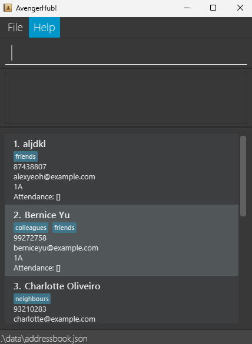
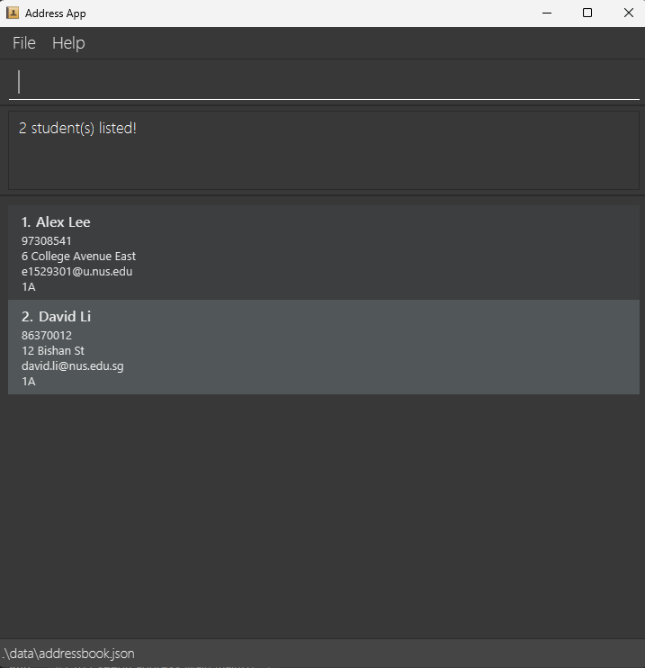
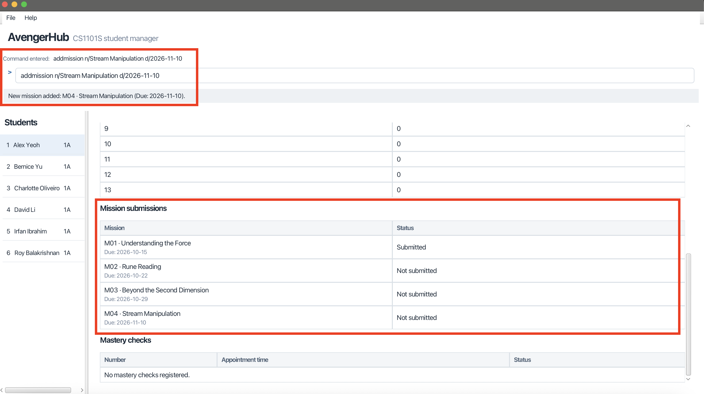
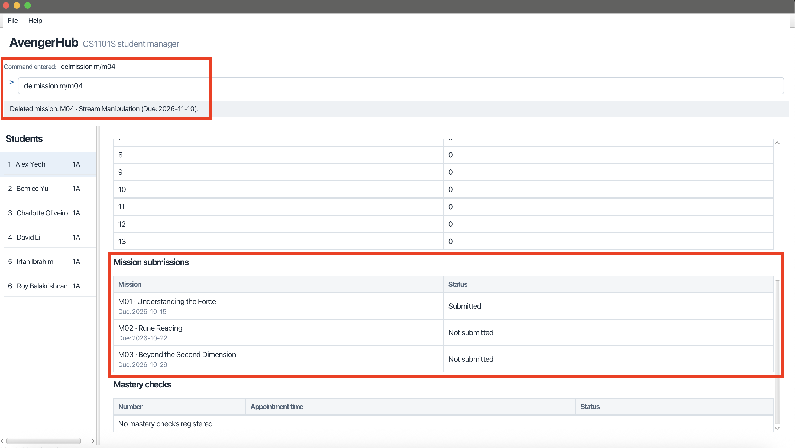
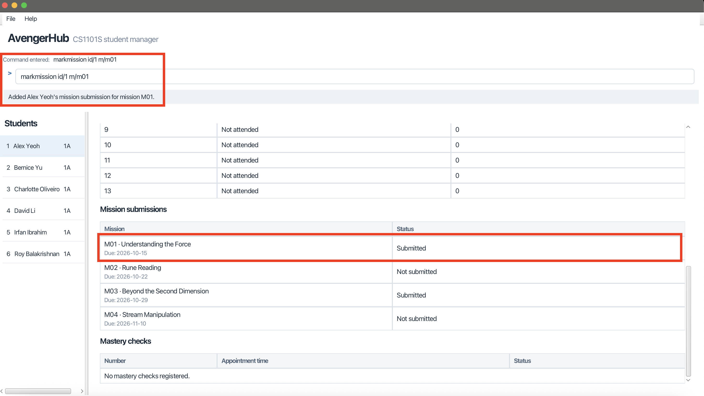
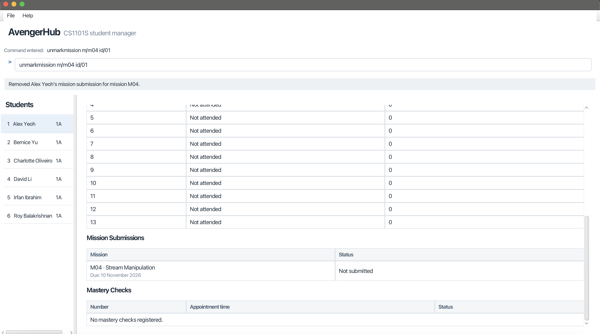

# AvengerHub User Guide

AvengerHub is a **desktop address book application for managing students, optimized for use through a Command Line Interface (CLI)** while retaining the benefits of a Graphical User Interface (GUI). If you type quickly, AvengerHub can help you manage students faster than traditional GUI applications.

<!-- * Table of Contents -->
<page-nav-print />

--------------------------------------------------------------------------------------------------------------------

## Quick start

1. Ensure that Java `25` or later is installed on your computer.<br>
   **Mac users:** Ensure you have the precise JDK version prescribed [here](https://se-education.org/guides/tutorials/javaInstallationMac.html).

1. Download the latest `.jar` file from [here](https://github.com/AY2627S1-CS2103T-F14a-1/tp/releases).

1. Copy the file to the folder you want to use as the _home folder_ for your AvengerHub.

1. Open a terminal, `cd` to the folder containing the JAR file, and run `java -jar avengerhub.jar`.<br>
   A GUI similar to the one below should appear in a few seconds. Note how the app contains some sample data in its address book.<br>
   

1. Type a command in the command box and press Enter to execute it. For example, type **`help`** and press Enter to open the help window.<br>
   Some example commands you can try:

   * `list` : Lists all students.

   * `addstudent n/John Doe p/98765432 e/johnd@example.com g/1A` : Adds a student named `John Doe` to the Address Book.

   * `delstudent 3` : Deletes the 3rd student shown in the current list.

   * `clear` : Deletes all students.

   * `exit` : Exits the app.

1. Refer to the [Features](#features) section below for details of each command.

--------------------------------------------------------------------------------------------------------------------

## Features

<box type="info" seamless>

**Notes about the command format:**<br>

* Words in `UPPER_CASE` are the parameters to be supplied by the user.<br>
  For example, in `addstudent n/NAME`, replace `NAME` with a value such as `John Doe`.

* Items in square brackets are optional.<br>
  For example, `n/NAME [t/TAG]` can be used as `n/John Doe t/friend` or as `n/John Doe`.

* Items followed by `...` can appear zero or more times.<br>
  For example, `[t/TAG]... ` may be omitted, or written as `t/friend` or `t/friend t/family`.

* Prefixed parameters can be in any order unless a command states otherwise. An `INDEX`, when required, comes first.<br>
  For example, if the command specifies `n/NAME p/PHONE_NUMBER`, `p/PHONE_NUMBER n/NAME` is also acceptable.

* Extraneous parameters for commands that take no parameters, such as `help`, `list`, `exit`, and `clear`, are ignored.<br>
  For example, `help 123` is interpreted as `help`.

* If you are using a PDF version of this document, be careful when copying and pasting commands that span multiple lines as space characters surrounding line-breaks may be omitted when copied over to the application.
</box>

### Viewing help: `help`

Shows a message explaining how to access the help page.


Format: `help`


### Adding a student: `addstudent`

Adds a student to the address book.

Format: `addstudent n/NAME p/PHONE_NUMBER e/EMAIL [t/TAG]... g/STUDIO_GROUP`

<box type="tip" seamless>

**Tip:** A student can have any number of tags, including zero.
</box>

Examples:
* `addstudent n/John Doe p/98765432 e/johnd@example.com g/1A`
* `addstudent n/Betsy Crowe t/talkative e/betsycrowe@example.com p/1234567 t/smart g/1A`

### Listing all students: `list`

Shows a list of all students in the address book.

Format: `list`

### Viewing a student: `view`

Displays the profile of a student in the currently displayed student list.

Format: `view INDEX`

* `INDEX` refers to the student's index in the currently displayed list,
  including results from `find`.
* The index must be a positive integer identifying a displayed student.
* The profile displays the student's name, studio group, phone number,
  email address, tags, and configured missions with their submission statuses.
* Mission statuses are `Submitted` or `Not submitted`, based on the records
  maintained in AvengerHub.
* An empty mission catalogue displays `No missions configured.`
* Viewing preserves student records, submission records, and the current filter.
* Missing, invalid, or out-of-range indexes produce an error without changing
  stored records.

Examples:

* `list`, followed by `view 2`, displays the second student's profile.
* `find Betsy Crowe`, followed by `view 1`, displays the first student
  in those search results.

For example, viewing Amy Lee displays the feedback:

```text
Showing profile of Amy Lee
```

### Editing a student: `edit`

Edits an existing student in the address book.

Format: `edit INDEX [n/NAME] [p/PHONE] [e/EMAIL] [t/TAG]... [g/STUDIO_GROUP]`

* Edits the student at the specified `INDEX`. The index refers to the index number shown in the displayed student list. The index **must be a positive integer** 1, 2, 3, ...
* At least one of the optional fields must be provided.
* Existing values will be updated to the input values.
* When editing tags, all of the student's existing tags are removed; adding tags is not cumulative.
* To remove all of a student's tags, enter `t/` without a tag after it.

Examples:
*  `edit 1 p/91234567 e/johndoe@example.com` Edits the phone number and email address of the 1st student to be `91234567` and `johndoe@example.com` respectively.
*  `edit 2 n/Betsy Crower t/` Edits the name of the 2nd student to be `Betsy Crower` and clears all existing tags.

### Locating students by name: `find`

Finds students whose names contain any of the given keywords.

Format: `find [NAME_WORDS [, MORE_NAME_WORDS]...] [g/STUDIO_GROUP]...`

* Provide at least one name alternative or studio group.
* Name matching is case-insensitive and allows partial matches.
* Spaces mean AND: `alex lee` requires both words, in any order.
* Commas mean OR: `alex lee, brian` matches both `alex` and `lee`,
  or matches `brian`.
* Spaces around commas are optional.
* Empty alternatives are invalid: do not begin or end the name search
  with a comma, or use consecutive commas.
* Studio groups match exactly.
* Repeated group filters mean OR: `g/1A g/1B` matches either group.
* When names and groups are supplied, both filters must match.
* Place name alternatives before studio-group filters.

Examples:
* `find ale lee` matches `Alex Lee`, but not `Alex Lim`.
* `find alex, david` matches `Alex Lee` and `David Li`.
* `find alex, brian g/1A` matches Alex or Brian within studio group 1A.
* `find g/1A g/1B` finds students in either studio group.
  

### Deleting a student: `delstudent`

Deletes the specified student from the address book.

Format: `delstudent INDEX`

* Deletes the student at the specified `INDEX`.
* The index refers to the index number shown in the displayed student list.
* The index **must be a positive integer** 1, 2, 3, ...

Examples:
* `list` followed by `delstudent 2` deletes the 2nd student in the address book.
* `find Betsy` followed by `delstudent 1` deletes the 1st student in the results of the `find` command.

### Adding studio records: `addstudiorecord`

Records a student's studio attendance and effort for a studio week.

Format: `addstudiorecord INDEX w/WEEK ef/EFFORT`

* Adds a studio record for the student at the specified `INDEX` for the specified `WEEK`, with the specified `EFFORT` score.
* The index refers to the index number shown in the displayed student list. 
* The index **must be a positive integer** 1, 2, 3, ...
* The week must be an integer from **0 to 13**, inclusive.
* The effort score must be a whole number from **0 to 2147483647**, inclusive.
* Weeks without a record shown are considered absent with an effort score of `0`.
* Adding an existing record leaves both attendance and the effort score unchanged, even if a different score is supplied.
* The current list filter stays active.

Examples:

* `list` followed by `addstudiorecord 1 w/3 ef/30` records attendance and an effort score of 30 for week 3 for the first student displayed, if any.
* `find Betsy` followed by `addstudiorecord 1 w/13 ef/0` records attendance and an effort score of 0 for week 13 for the first student in the search results, if any.

For example, if the first student is Amy Bee and her week 3 studio record is not yet recorded, `addstudiorecord 1 w/3 ef/30` displays:

```text
Added Amy Bee's studio record for studio week 3.
```

### Deleting studio records: `delstudiorecord`

Removes a student's attendance record and effort score for a studio week. The student remains in the address book.

Format: `delstudiorecord INDEX w/WEEK`

* Deletes a studio record for the student at the specified `INDEX` for the specified `WEEK`.
* The index refers to the index number shown in the displayed student list.
* The index **must be a positive integer** 1, 2, 3, ...
* The week must be an integer from **0 to 13**, inclusive.
* If the studio record was already not recorded, the records remain unchanged.
* The current list filter stays active.

Examples:

* `list` followed by `delstudiorecord 1 w/3` removes the first student's week 3 studio record, if recorded, if any.
* `find Betsy` followed by `delstudiorecord 1 w/13` removes the week 13 studio record for the first student in the search results, if any.

For example, if the first student is Amy Bee and her week 3 studio record is recorded, `delstudiorecord 1 w/3` displays:

```text
Removed Amy Bee's record for studio week 3.
```

### Editing studio records: `editstudiorecord`

Edit a student's studio effort for a studio week.

Format: `editstudiorecord INDEX w/WEEK ef/EFFORT`

* `INDEX` identifies a student in the **currently displayed list**, including results from `find`. It must be a positive integer that corresponds to a displayed student.
* `WEEK` must be an integer from **0 to 13**, inclusive. AvengerHub uses these week numbers to allow tutors to flexibly mark studio records across the semester's 13 weeks. Use the actual week number as defined in the NUS student calendar.
* Weeks outside this range, such as `-1` or `14`, are rejected with an error message. The existing studio records remain unchanged.
* `EFFORT` is the student's effort score for that studio week. It must be a whole number from **0 to 2147483647**, inclusive. Negative numbers, decimals, non-numeric values, and values above this range are rejected without changing existing records.
* All three arguments are required. Put `INDEX` before the prefixed arguments, and specify `w/` and `ef/` exactly once each. Extra arguments are rejected. Omitting `ef/EFFORT` displays `Specify an effort score using ef/EFFORT.`
* Enter `INDEX` and `WEEK` as integers without signs, decimal points, or leading zeros. For example, use `3`, not `+3`, `3.0`, or `03`.
* The command word and the `w/` and `ef/` prefixes are case-insensitive: `EDITSTUDIORECORD 1 W/3 EF/30` is also accepted.
* If the studio record was initially not recorded, the records remain unchanged and a message explains that no changes were made.
* The current list filter stays active.

Examples:

* `list` followed by `editstudiorecord 1 w/3 ef/30` edits studio record's effort score to 30 for week 3 for the first student displayed, if any.
* `find Betsy` followed by `editstudiorecord 1 w/13 ef/0` edits studio's effort score to 0 for week 13 for the first student in the search results, if any.

For example, if the first student is Amy Bee and her week 3 studio record is recorded, `editstudiorecord 1 w/3 ef/30` displays:

```text
Edited Amy Bee's studio record for studio week 3.
```

### Adding a mastery check: `addmc`

Adds a numbered mastery check appointment for a student.

Format: `addmc INDEX num/NUMBER dt/DATE-TIME`

* `INDEX` must be a positive integer identifying a student in the **currently displayed list**, including `find` results.
* `NUMBER` must be an integer from **1 to 2147483647**, inclusive. Numbers are unique within each student's appointments.
* `DATE-TIME` must be a real date and 24-hour time in `dd-MM|HH:mm` format, such as `29-10|13:30`.
  The current year is filled in automatically. Impossible dates, `24:00`, and times with seconds are rejected.
* Supply lowercase `num/` and `dt/` exactly once each, in either order, after `INDEX`.
* New appointments show **Not completed**. Adding an existing number leaves its time and status unchanged.
* Any invalid input produces an error without changing records.

All four mastery check commands use the same `INDEX` and `NUMBER` rules. They preserve other student records
and the current list filter. Changes are saved automatically and retained after restart.
Run `view INDEX` to inspect the Number, Appointment time, and Status columns.

Example: 

`addmc 1 num/2 dt/29-10|13:30`, followed by `view 1`, shows appointment 2 at `Oct 29, 13:30` as Not completed.

### Deleting a mastery check: `delmc`

Removes a numbered mastery check appointment for a student, including its completion status.

Format: `delmc INDEX num/NUMBER`

* `INDEX` must be a positive integer identifying a student in the **currently displayed list**, including `find` results.
* `NUMBER` must be an integer from **1 to 2147483647**, inclusive. Numbers are unique within each student's appointments.
* Supply the lowercase `num/` prefix exactly once.
* If the number is not registered for that student, the command reports that no changes were made.
* Other appointments and the student remain in the address book.
* Any invalid input produces an error without changing records.

Example: 

`delmc 1 num/2` removes appointment 2 from the first displayed student, if registered.

### Marking a mastery check as completed: `markmc`

Marks an existing appointment as **Completed** without changing its appointment time.

Format: `markmc INDEX num/NUMBER`

* `INDEX` must be a positive integer identifying a student in the **currently displayed list**, including `find` results.
* `NUMBER` must be an integer from **1 to 2147483647**, inclusive. Numbers are unique within each student's appointments.
* Supply the lowercase `num/` prefix exactly once. The number must be registered for that student.
* Marking an already completed appointment reports that no changes were made.
* Any invalid input produces an error without changing records.

Example: 

`markmc 1 num/2`, followed by `view 1`, shows appointment 2 as Completed.

### Unmarking a mastery check as completed: `unmarkmc`

Changes an existing appointment's status to **Not completed** without deleting it or changing its time.

Format: `unmarkmc INDEX num/NUMBER`

* `INDEX` must be a positive integer identifying a student in the **currently displayed list**, including `find` results.
* `NUMBER` must be an integer from **1 to 2147483647**, inclusive. Numbers are unique within each student's appointments.
* Uses the same index, number, and registration rules as `markmc`. 
* Unmarking an appointment that is already incomplete reports that no changes were made. 
* Any invalid input produces an error without changing records.

Example: 

`unmarkmc 1 num/2`, followed by `view 1`, shows appointment 2 as Not completed.

### Adding a mission: `addmission`

Creates one mission shared by all students. Adding a mission does not mark anyone as having
submitted it; students without a submission record show **Not submitted**.

Format: `addmission n/NAME d/DEADLINE`

* Supply exactly one lowercase `n/` and one lowercase `d/`, in either order. Do not put text
  before the first prefix. The command word is case-insensitive.
* `NAME` must not be blank. Multiple words and ordinary punctuation are allowed.
  Leading and trailing whitespace is removed, and internal whitespace becomes a single space.
  Letter case and punctuation are preserved for display and saving.
* Names are unique across the mission catalogue, ignoring case and whitespace differences.
  `Rune Reading` and `rune reading` are duplicates, even with different deadlines.
  Adding extra spaces before, after, or between the words also counts as the same name.
  `RuneReading` and `Rune Reading!` remain different names.
* `DEADLINE` must be a real calendar date in `YYYY-MM-DD` format. For example, `2024-02-29`
  is valid but `2026-15-32` is not. Times and single-digit months or days are rejected.
  Past deadlines are accepted for recording existing assignments.
* The app assigns an ID such as `M01`. Use the ID shown in the success message for submission commands.
* Successful additions are saved automatically. Invalid or duplicate additions do not change
  the catalogue, consume an ID, or save the data file. Existing students and their list filter are preserved.

Examples:

* `addmission n/Rune Reading d/2026-10-20`
* `addmission d/2024-02-29 n/Mission 1:  Rune Reading!` stores the name `Mission 1: Rune Reading!`.

For an empty catalogue with its allocation counter at 1, the first example displays:

```text
New mission added: M01 · Rune Reading (Due: 2026-10-20)
```

Missing or blank names produce `Provide a mission name using n/NAME.` A valid name without
a deadline produces `Specify a deadline in YYYY-MM-DD format using d/DEADLINE.` Unexpected text
before the prefixes produces a format error with usage instructions. Repeated prefixes identify the repeated fields;
invalid dates
produce their respective constraint messages. An existing name produces
`This mission already exists in the mission list.`

If all mission IDs have been allocated, the command reports
`No further mission IDs can be allocated.` and leaves the catalogue and saved file unchanged.



### Deleting a mission: `delmission`

Format: `delmission m/MISSIONID`

Example: `delmission m/M03`

Use exactly one lowercase `m/` prefix. Mission IDs are case-insensitive, so `m/m03` also
identifies `M03`. Numeric-only values such as `m/3` are rejected. Use the stable mission ID,
not a student index or a position in the displayed list.

Deletion removes the mission and its submission records from **every student**, including
students hidden by the current filter. Student details, studio records, and other missions are
preserved. The current student filter stays active. The result area shows deletion feedback;
run `view INDEX` to see the updated profile. Deletion is automatically saved and survives restart.
Deleted IDs are not reused. Unknown or invalid IDs leave data unchanged.



### Recording a mission submission: `markmission`

Format: `markmission INDEX m/MISSION_ID`

* `INDEX` identifies a student in the **currently displayed list**, including `find` results.
* The index must be a positive integer without a sign or leading zeros.
* `MISSION_ID` must identify a configured mission, for example `M01` or `M105`.
* Use the lowercase `m/` prefix exactly once. Mission IDs are case-insensitive: `m/m01` and `m/M01` both identify `M01`. IDs are displayed and saved in uppercase.
* Each mission ID identifies one configured assignment.
* Repeated marking reports that the submission is already recorded and changes nothing.
* Other students, other submissions, studio records, and the current student filter are preserved.
* Records are maintained manually. Not submitted means no submission is recorded in AvengerHub.

Example: `markmission 1 m/M01`, followed by `view 1`, displays M01 as Submitted.
An unknown mission ID or invalid command leaves existing records unchanged.



### Removing a submission record: `unmarkmission`

Format: `unmarkmission INDEX m/MISSION_ID`

Uses the same index and mission ID rules as `markmission`. This removes only the selected student's
submission record; it does not delete the student or the mission. Unmarking an unrecorded submission
reports that no changes were made.

Example: `unmarkmission 1 m/M01`, followed by `view 1`, displays M01 as Not submitted.

The profile displays configured mission descriptions and deadlines. An empty catalogue shows
“No missions configured.”



### Editing a mission: `editmission`

Changes a shared mission's name, deadline, or both.

Format: `editmission m/MISSION_ID [n/NAME] [d/DEADLINE]`

* Supply exactly one lowercase `m/` prefix and an existing mission ID.
* Supply at least one lowercase `n/` or `d/` prefix. Each may appear once.
* Prefixes may appear in any order. Do not put text before the first prefix.
* The command word and mission ID are case-insensitive.
* Names and deadlines follow the same validation rules as `addmission`.
* Omitted fields retain their existing values.
* The new name must not duplicate another mission's name, ignoring case and
  whitespace differences. Keeping the mission's own name is allowed.
* The mission ID, submission records, student details, and student filter
  remain unchanged.
* Missions are shared: editing affects their displayed details for every
  student, including students hidden by the current filter.
* An unchanged name and deadline produce no-change feedback.
* Successful edits are saved automatically. Invalid edits leave records unchanged.
* Run `view INDEX` again to inspect updated mission details.

Examples:

* `editmission m/M01 n/Rune Reading`
* `editmission m/M01 d/2026-10-22`
* `editmission m/M01 n/Rune Reading d/2026-10-22`

### Listing overdue submissions: `listoverdue`

Shows missing mission submissions for students in the currently displayed
student list, where the mission deadline has passed.

Format: `listoverdue`

* Only students in the currently displayed student list are included.
  Students hidden by `find` are excluded.
* A submission is overdue when no submission is recorded for the student
  and today's date is after the mission's deadline.
* A mission due today or in the future is not overdue.
* Today's date follows your computer's local date and time zone.
* Each result row identifies a student and a missing mission, including
  the mission's name and deadline.
* A student can appear more than once if they have multiple overdue submissions.
* Student numbers match the indexes in the displayed student list.
  Use `view INDEX` to inspect a student's profile.
* Results are ordered by displayed student index, then numeric mission ID.
* Recording a submission removes it from subsequent overdue results.
  Submission timestamps are not recorded, so this report does not identify
  submissions that were completed late.
* If no overdue submissions exist within the current student list, the command
  displays `No overdue submissions in the current student list.`
* Student records, mission definitions, submission records, and the current
  student filter remain unchanged.
* Run `list` first to include all students.
* Like `list`, this command ignores extra arguments.

Examples:

* `list`, followed by `listoverdue`, shows overdue submissions for all students.
* `find g/1A`, followed by `listoverdue`, shows overdue submissions only for
  students in studio group 1A.
* `find Betsy Crowe`, followed by `listoverdue`, shows overdue submissions
  for students matching that name.
### Listing mission submissions: `listmissions`

Shows which students in the currently displayed student list submitted a mission.

Format: `listmissions m/MISSION_ID`

* Supply exactly one lowercase `m/` prefix and an existing mission ID.
* The command word and mission ID are case-insensitive.
* Students hidden by `find` are excluded.
* Result numbers retain the indexes in the displayed student list.
  A result numbered `3` can therefore be inspected using `view 3`.
* The student filter, submission records, and mission catalogue are unchanged.
* If no displayed students submitted the mission, the command reports that no
  submissions are recorded within the current student list.
* Run `list` first to include all students.

Example: `find g/1A`, followed by `listmissions m/M01`, lists students in
studio group 1A with a recorded submission for M01.

### Clearing all entries: `clear`

Clears all entries from the address book.

Format: `clear`

### Exiting the program: `exit`

Exits the program.

Format: `exit`

### Saving the data

AvengerHub automatically saves data after every successfully executed command. You do not need to save manually.

Mission submission marking and unmarking are saved automatically and retained when you reopen the application. Invalid mission commands leave existing records unchanged.

### Editing the data file

AvengerHub's address book data is saved automatically as a JSON file `[JAR file location]/data/addressbook.json`. Advanced users are welcome to update data directly by editing that data file.

<box type="warning" seamless>

**Caution:**
Back up the file before editing it manually. If loading fails because of malformed JSON,
invalid student details, or invalid mission catalogue data, AvengerHub logs the error and
opens an empty address book. The entire dataset is rejected; no partial records are retained.
Startup leaves the invalid file unchanged. The next successfully executed command, including
`list`, overwrites that file with the current in-memory address book, which may be empty.
Failed commands do not save. A missing file instead loads the sample data.
</box>

--------------------------------------------------------------------------------------------------------------------

## FAQ

**Q**: How do I transfer my data to another computer?<br>
**A**: Install the app on the other computer and overwrite the data file it creates with the data file from your previous AvengerHub home folder.

--------------------------------------------------------------------------------------------------------------------

## Known issues

1. **When using multiple screens**, if you move the application to a secondary screen, and later switch to using only the primary screen, the GUI will open off-screen. The remedy is to delete the `preferences.json` file created by the application before running the application again.
2. **If you minimize the Help Window** and then run the `help` command (or use the `Help` menu, or the keyboard shortcut `F1`) again, the original Help Window will remain minimized, and no new Help Window will appear. The remedy is to manually restore the minimized Help Window.

--------------------------------------------------------------------------------------------------------------------

## Command summary

Action     | Format, Examples
-----------|----------------------------------------------------------------------------------------------------------------------------------------------------------------------
**Add student**    | `addstudent n/NAME p/PHONE_NUMBER e/EMAIL [t/TAG]... g/STUDIO_GROUP` <br> e.g., `addstudent n/James Ho p/22224444 e/jamesho@example.com  t/smart t/talkative g/1A`
**Delete student** | `delstudent INDEX`<br> e.g., `delstudent 3`
**View student** | `view INDEX`<br> e.g., `view 1`
**Edit student**   | `edit INDEX [n/NAME] [p/PHONE_NUMBER] [e/EMAIL] [t/TAG]... [g/STUDIO_GROUP]`<br> e.g.,`edit 2 n/James Lee e/jameslee@example.com g/1A`
**Add studio record** | `addstudiorecord INDEX w/WEEK ef/EFFORT`<br> e.g., `addstudiorecord 1 w/3 ef/30`
**Delete studio record** | `delstudiorecord INDEX w/WEEK`<br> e.g., `delstudiorecord 1 w/3`
**Edit studio record** | `editstudiorecord INDEX w/WEEK ef/EFFORT`<br> e.g., `editstudiorecord 1 w/3 ef/30`
**Add mastery check** | `addmc INDEX num/NUMBER dt/DATE-TIME`<br> e.g., `addmc 1 num/2 dt/29-09\|23:59`                                                                                    
**Delete mastery check** | `delmc INDEX num/NUMBER`<br> e.g. `delmc 1 num/2`
**Mark mastery check** | `markmc INDEX num/NUMBER`<br> e.g. `markmc 1 num/2`
**Unmark mastery check** | `unmarkmc INDEX num/NUMBER`<br> e.g. `unmarkmc 1 num/2`
**Add mission** | `addmission n/NAME d/DEADLINE`<br> e.g., `addmission n/Rune Reading d/2026-10-20`
**Delete mission** | `delmission m/MISSIONID`<br> e.g., `delmission m/M03`
**Record mission submission** | `markmission INDEX m/MISSION_ID`<br> e.g., `markmission 1 m/M01`
**Remove mission submission** | `unmarkmission INDEX m/MISSION_ID`<br> e.g., `unmarkmission 1 m/M01`
**Edit mission** | `editmission m/MISSION_ID [n/NAME] [d/DEADLINE]`<br> e.g., `editmission m/M01 n/Rune Reading d/2026-10-22`
**List overdue submissions** | `listoverdue`
**List mission submissions** | `listmissions m/MISSION_ID`<br> e.g., `listmissions m/M01`
**Clear**  | `clear`
**Find**   | `find KEYWORD [MORE_KEYWORDS]`<br> e.g., `find James Jake`
**List**   | `list`
**Help**   | `help`
